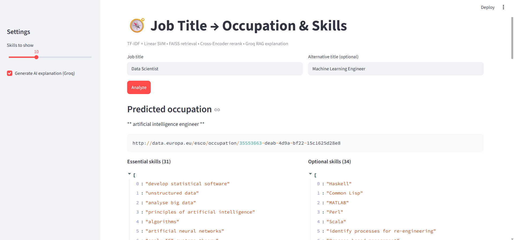
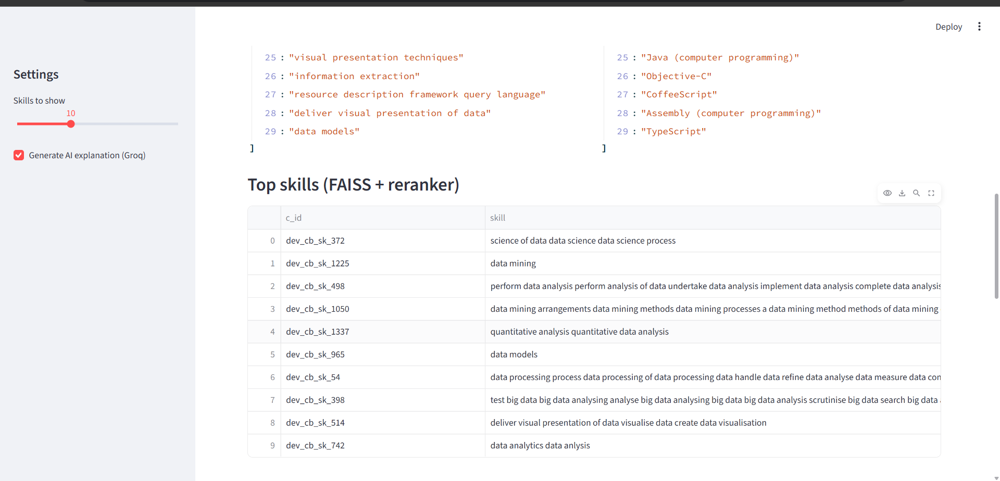
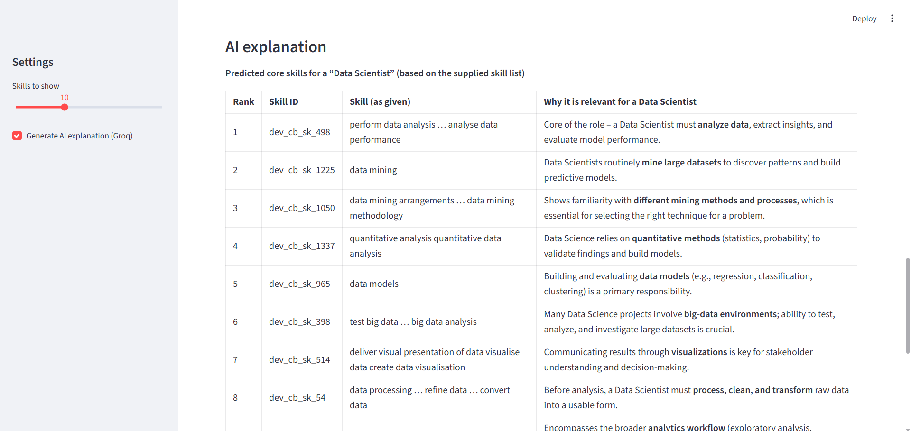
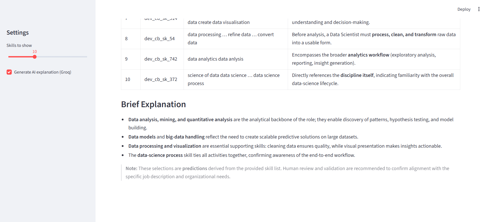

# Job Skill Extraction and Job Title Matching using NLP

An end-to-end Natural Language Processing (NLP) project that predicts occupations from job titles, retrieves relevant skills, and generates AI-powered explanations using Retrieval-Augmented Generation (RAG).

The project combines Machine Learning, semantic search, vector similarity, cross-encoder reranking, and Generative AI in an interactive Streamlit web application.

## Table of Contents

- [Project Overview](#project-overview)
- [Key Features](#key-features)
- [Technologies Used](#technologies-used)
- [Project Workflow](#project-workflow)
- [Models and Evaluation Results](#models-and-evaluation-results)
- [Project Structure](#project-structure)
- [Installation and Setup](#installation-and-setup)
- [Running the Application](#running-the-application)
- [Application Screenshots](#application-screenshots)
- [API Key Security](#api-key-security)
- [Limitations and Future Improvements](#limitations-and-future-improvements)

## Project Overview

Job titles often vary across organizations, even when they refer to similar occupations. Identifying the correct occupation and extracting relevant skills from job titles can help improve job matching and skills analysis.

This project addresses the problem through two main tasks:

**Task A — Job Title Matching**

- Processes job titles using TF-IDF vectorization.
- Predicts the corresponding occupation using a trained Linear Support Vector Machine (Linear SVM) classifier.
- Supports matching between alternative job titles and occupation categories.

**Task B — Job Skill Extraction**

- Retrieves relevant skills using sentence embeddings and FAISS similarity search.
- Improves the ranking of retrieved skills using a Cross-Encoder reranker.
- Uses a Retrieval-Augmented Generation (RAG) pipeline to generate AI-powered explanations of the retrieved results.

The project uses the TalentCLEF 2025 job title and skill intelligence dataset.

## Key Features

- **Occupation Prediction:** Predicts an occupation from a job title using a trained machine learning model.
- **Alternative Job Title Matching:** Accepts an optional alternative title for comparison.
- **Semantic Skill Retrieval:** Retrieves relevant skills using sentence-transformer embeddings and FAISS.
- **Cross-Encoder Reranking:** Refines the ordering of retrieved skills to improve relevance.
- **AI-Powered Explanations:** Uses a Groq-hosted large language model through LangChain to explain the results.
- **RAG Pipeline:** Grounds the generated explanation in retrieved skill information.
- **Interactive Streamlit Frontend:** Provides a user-friendly interface for entering job titles, viewing predicted occupations, exploring skills, and reading AI-generated explanations.
- **Saved Model Artifacts:** Loads trained models, vectorizers, skill data, embeddings, and the FAISS index from local files.

## Technologies Used

| Category | Technologies |
|---|---|
| Programming Language | Python |
| Data Processing | Pandas, NumPy |
| Machine Learning | Scikit-learn |
| Text Vectorization | TF-IDF |
| Occupation Classification | Linear SVM |
| Semantic Embeddings | Sentence Transformers (`all-MiniLM-L6-v2`) |
| Vector Search | FAISS |
| Reranking | Cross-Encoder (`ms-marco-MiniLM-L-6-v2`) |
| Generative AI | Groq API, OpenAI GPT-OSS 120B (`openai/gpt-oss-120b`) |
| LLM Orchestration | LangChain |
| Retrieval-Augmented Generation | RAG |
| Frontend | Streamlit |
| Model Storage | Pickle, NumPy, FAISS index |

## Project Workflow

### Task A: Job Title Matching

1. Load and preprocess the job title dataset.
2. Convert job title text into numerical features using TF-IDF.
3. Train and evaluate classification models.
4. Tune the Linear SVM classifier.
5. Save the trained classifier and TF-IDF vectorizer.
6. Use the saved artifacts to predict occupations for new job titles.

**Models evaluated:**

- Logistic Regression
- Linear SVM
- Multinomial Naive Bayes

The tuned Linear SVM was selected for occupation prediction based on its evaluation results.

### Task B: Job Skill Extraction

1. Load the job-skill relationships and skill corpus.
2. Generate semantic embeddings using `all-MiniLM-L6-v2`.
3. Normalize the embeddings and build a FAISS similarity-search index.
4. Retrieve candidate skills for the input job title.
5. Rerank candidate skills using a Cross-Encoder.
6. Present the most relevant skills in the application.
7. Optionally generate a natural-language explanation using the RAG pipeline and Groq.

### Frontend: Streamlit Application

The Streamlit frontend connects the saved occupation classifier and skill retrieval pipeline in one interface. Users can enter a job title, optionally provide an alternative title, choose how many skills to display, and request an AI-generated explanation.

## Models and Evaluation Results

### Task A — Occupation Classification

The following results were obtained during model evaluation.

| Model | Accuracy | Precision | Recall | F1-score |
|---|---:|---:|---:|---:|
| Tuned Linear SVM | 0.893588 | 0.902553 | 0.893588 | 0.882945 |
| Linear SVM | 0.891161 | 0.900497 | 0.891161 | 0.880313 |
| Multinomial Naive Bayes | 0.867244 | 0.869718 | 0.867244 | 0.849259 |
| Logistic Regression | 0.816291 | 0.812407 | 0.816291 | 0.791654 |

The tuned Linear SVM achieved the best recorded results among the evaluated models.

**Tuned Linear SVM metrics:**

- Accuracy: 89.36%
- Precision: 90.26%
- Recall: 89.36%
- F1 Score: 88.29%
- Best recorded hyperparameter: `C = 5.0`

### Task B — Semantic Skill Retrieval

The initial Sentence Transformer + FAISS retrieval baseline was evaluated using Precision@K, Recall@K, and Hit Rate@K.

| K | Precision | Recall | Hit Rate | Evaluated Queries |
|---:|---:|---:|---:|---:|
| 5 | 0.365789 | 0.024264 | 0.812500 | 304 |
| 10 | 0.287171 | 0.036951 | 0.851974 | 304 |
| 20 | 0.218421 | 0.054037 | 0.911184 | 304 |

These results represent the recorded **baseline retrieval evaluation**, not a claim that the complete reranked or RAG pipeline achieved the same scores. The RAG-generated explanation is a separate generation stage.

## Project Structure

```text
Job-Skill-Extraction-and-Job-Title-Matching-using-NLP/
│
├── .streamlit/
│
├── Data/
│   ├── TaskA - modified set/
│   └── TaskB/
│
├── Models/
│   ├── skills_corpus.pkl
│   ├── skill_embeddings.npy
│   ├── skill_faiss.index
│   ├── tfidf_vectorizer.pkl
│   └── tuned_linear_svm_model.pkl
│
├── Notebooks/
│   ├── NLP Project.ipynb
│   └── NLP Project part 2 .ipynb
│
├── screenshots/
│   ├── 1_job_title_input_and_predicted_occupation.png
│   ├── 2_top_skills_faiss_reranker_table.png
│   ├── 3_ai_explanation_rag_structured_output.png
│   └── 4_ai_explanation_rag_summary_and_footer.png
│
├── .gitignore
├── app.py
├── README.md
└── requirements.txt
```

## Installation and Setup

### 1. Clone the Repository

```bash
git clone https://github.com/kunapareddy-Jagadeeswari/Job-Skill-Extraction-and-Job-Title-Matching-using-NLP.git
cd Job-Skill-Extraction-and-Job-Title-Matching-using-NLP
```

### 2. Create a Virtual Environment

```bash
python -m venv venv
```

Activate it on Windows:

```powershell
.\venv\Scripts\Activate.ps1
```

If you use Command Prompt instead:

```cmd
venv\Scripts\activate
```

### 3. Install Dependencies

```bash
python -m pip install --upgrade pip
pip install -r requirements.txt
```

### 4. Configure the Groq API Key

Create a `secrets.toml` file inside the `.streamlit/` directory:

```toml
GROQ_API_KEY = "your_groq_api_key"
```

The application reads this key through Streamlit secrets. It also supports the `GROQ_API_KEY` environment variable.

Keep the actual API key private and add `.streamlit/secrets.toml` to `.gitignore`. Do not commit your secrets file to GitHub.

## Running the Application

Run the following command from the project root directory:

```bash
python -m streamlit run app.py
```

Streamlit will start the application and display a local URL, usually:

```text
http://localhost:8501
```

Open the URL in your browser to use the application.

## Application Screenshots

### 1. Job Title Input and Predicted Occupation



### 2. Retrieved Skills and Reranking Results



### 3. AI-Generated Explanation — Structured Output



### 4. AI-Generated Explanation — Summary and Footer



## API Key Security

The application uses a Groq API key to generate AI-powered explanations through the Groq API.

The API key is configured in `.streamlit/secrets.toml` and accessed by the application through Streamlit secrets. The application also supports reading the key from the `GROQ_API_KEY` environment variable.

Example `.streamlit/secrets.toml` configuration:

```toml
GROQ_API_KEY = "your_groq_api_key"
```

**Security practices:**

- Keep the API key out of `app.py` and other source files.
- Add `.streamlit/secrets.toml` to `.gitignore` so the file containing your secret is not committed to GitHub.
- Never publish or share the actual API key.
- If the key is accidentally exposed, revoke it and generate a replacement.

**Note:** Storing the key in Streamlit secrets keeps it separate from the application source code. This does not automatically guarantee encryption of the file on your local machine.

## Limitations and Future Improvements

- Improve skill retrieval using further embedding, retrieval, and reranking experiments.
- Evaluate the complete reranked pipeline separately using Precision@K, Recall@K, and Hit Rate@K.
- Add more job titles and alternative-title examples for testing.
- Improve handling of ambiguous or uncommon job titles.
- Evaluate the quality and faithfulness of generated explanations.
- Deploy the Streamlit application so users can access it online.

## Conclusion

This project combines machine learning, NLP, semantic search, reranking, and Retrieval-Augmented Generation to build a job title matching and skill extraction system. The Streamlit frontend makes the pipeline accessible through an interactive interface, while the saved model artifacts allow the application to reuse the trained occupation classifier and skill retrieval components.

The project demonstrates practical experience with text classification, sentence embeddings, vector databases, cross-encoder reranking, LangChain, Groq, RAG, and Streamlit.